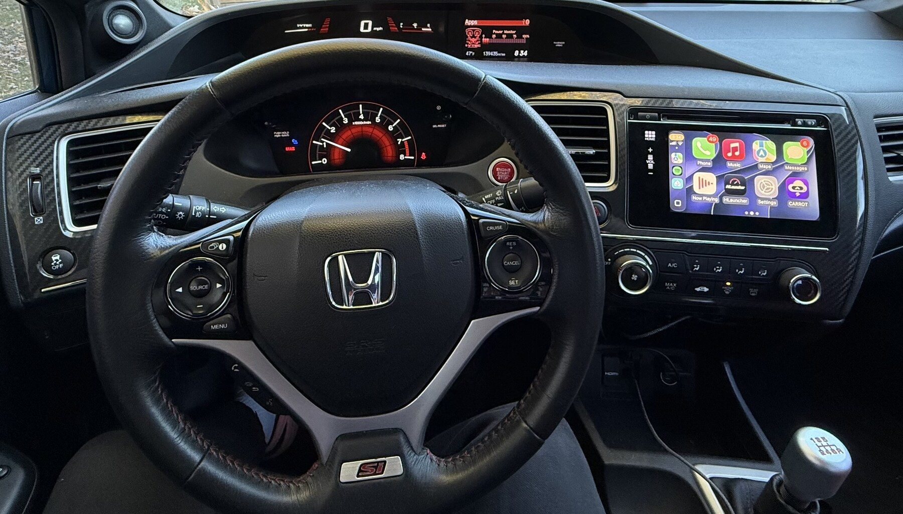

<h1 align="center">
  
</h1>

  
  
  
  
  

A Raspberry Pi launcher for factory Honda radios with the legacy HDMI-based
HondaLink phone-app integration, tested on my 2014 Civic Si. It adds CarPlay,
Android Auto, and live OBD gauges through plugins.

*CarPlay running through HLauncher on the factory radio in my 2014 Civic Si.*

HLauncher implements the phone side of the Civic's legacy HondaLink connection.
HDMI carries video and media audio, and Bluetooth carries the handshake and
touchscreen input. Open **HondaLink** on the radio to use HLauncher. The radio
firmware stays intact.

Tested with **Raspberry Pi 4 Model B boards with 2 GB and 4 GB RAM**, running
**Raspberry Pi OS Lite Bookworm 64-bit**. The 4 GB model was noticeably smoother,
but the 2 GB model ran fine. Other Pi models and OS versions are unverified.
This is development software. See the plugin guides for limitations. Reverse-engineering
progress and future native-radio experiments are on [my blog](https://www.evanhorsley.com/blog/).

## Vehicle compatibility

[See vehicle compatibility](docs/vehicle-compatibility.md).

## Hardware

- HDMI-equipped HondaLink radio with the older phone-app integration.
- Raspberry Pi 4, microSD card, card reader and suitable Pi power supply.
- Micro-HDMI-to-HDMI cable from **HDMI0** (nearest USB-C power) to the radio.
- A phone/adapter for the plugins you want to use:

| Plugin | Required connection | Guide |
| --- | --- | --- |
| CarPlay | iPhone and compatible Carlinkit USB adapter connected to the Pi | [CarPlay](plugins/carplay/README.md) |
| Android Auto | Android phone connected directly to a Pi USB host port | [Android Auto](plugins/android-auto/README.md) |
| OBD Gauges | HondaLink vehicle data from the factory radio | [OBD Gauges](plugins/obd/README.md) |

Power currently comes from a cigarette-lighter USB plug supplying **3 A**. The Pi
loses power whenever the car cuts power to the socket, without a clean shutdown.
For now, this setup relies on **read-only filesystem mode (Storage protection)**
to reduce the risk from abrupt power loss. A low-power mode or safer shutdown
method is planned.

## Flash and set up

1. Download **`HLauncher-VERSION-pi4.img.xz`** and `SHA256SUMS` from
   [Releases](https://github.com/evy0311/HLauncher/releases). Choose the disk image,
   rather than a source archive or `.hlu` update file.
2. Verify the download against `SHA256SUMS`; the [flashing guide](docs/install.md#download-and-verify)
   has commands for macOS, Linux and Windows.
3. Flash the image to your microSD card with either tool:
   - [Raspberry Pi Imager](https://www.raspberrypi.com/software/): select
     **Raspberry Pi 4 → Use Custom**, choose the image and card, and skip OS customisation.
   - [balenaEtcher](https://etcher.balena.io/): choose **Flash from file**, select
     the image, then select your card and flash.

   **Flashing erases the selected card.** Let verification finish, then eject it.
4. Insert the card into the Pi. Connect HDMI0 to the radio and any USB device
   needed by your plugin, then power on the Pi.
5. Within five minutes of booting, open **Settings → Phone → Connect a phone →
   Add Bluetooth device** on the radio. Select **HLauncher** and confirm pairing.
6. Open **HondaLink** on the radio and follow the setup wizard to choose your
   apps, startup app and appearance. Enable **Storage protection** for the
   power setup above, then restart when prompted. Wi-Fi setup is optional.

The image uses the tested **720×480 HDMI input**; forcing the panel's 800×480
resolution cropped the picture. See [display setup](docs/setup.md#hdmi) for other
hardware. To install from source instead, use the [source setup guide](docs/setup.md).

## Updates and recovery

On update-enabled images, **Settings → System → Software updates** checks for
signed releases and can restore the previously installed application version.
Checks and installation are manual. A signed **`.hlu`** file can also be uploaded
from a phone/computer through the local setup page. See [updates](docs/updates.md).

Wi-Fi starts off on a fresh install. To set it up, open **Settings → System →
Wi-Fi → Setup hotspot** and select **Start setup hotspot**. Join the
**HLauncher-XXXX** hotspot with the device's setup password, then open
[the setup page](http://192.168.4.1:8080). Sign in as **`hlauncher`** with that
same device password. The radio's hotspot screen and the SD card's
`HLAUNCHER-SETUP.txt` show it.

SSH starts off. Enable it from **Wi-Fi → SSH access** on the radio.
The initial SSH credentials are **`hlauncher` / `ilovevtec1234`**. Use a trusted
network and change the SSH password with `passwd`. See [first boot and recovery](docs/onboarding.md).

## Development and documentation

- [Source installation and troubleshooting](docs/setup.md)
- [Contributing to HLauncher](CONTRIBUTING.md)
- [Installing plugins](docs/plugins.md#install-on-the-radio) · [Creating a plugin](docs/plugins.md#author-and-package-a-plugin) · [Building with an AI agent](docs/plugins.md#build-a-plugin-with-an-ai-agent)
- [Audio and EQ](docs/audio.md) · [Radio controls](docs/radio-buttons.md)
- [Development and checks](docs/development.md)
- [Building images and signed releases](docs/updates.md#build-a-complete-release)

## Credits and license

HLauncher and its HondaLink reverse engineering are by **Evan Horsley (evy0311)**.
Licensed under [GPL-3.0](LICENSE), with original attribution retained as specified
in [NOTICE](NOTICE). CarPlay uses [node-CarPlay by Rhys Morgan](https://github.com/rhysmorgan134/node-CarPlay);
Android Auto uses OpenAuto/aasdk; the FFmpeg helper is by
[rsyrnicki](https://github.com/rsyrnicki). See [third-party notices](THIRD_PARTY_NOTICES.md).

## Disclaimer

HLauncher is an independent community project. It is not affiliated with,
sponsored by or endorsed by Honda, Apple, Google or Carlinkit. Using the radio's existing HondaLink connection
does not mean this software has been tested or approved by those companies.
It is provided **as is, without warranty**, under the terms of the [license](LICENSE).
Use it at your own risk, verify compatibility with your setup, and perform setup
and testing while parked. Do not rely on it for safety-critical vehicle functions.

The driver is responsible for safe vehicle operation, maintaining attention to
the road and complying with all applicable traffic laws. Complete setup and
adjustments while safely parked. Do not operate HLauncher, watch video or use
features that distract you while driving; passengers must not distract the driver.
To the extent permitted by applicable law, the authors and contributors accept
no liability for distracted driving, misuse, accidents, injury, property damage
or other loss arising from use of this software. This notice does not exclude
rights or liabilities that cannot legally be excluded.
